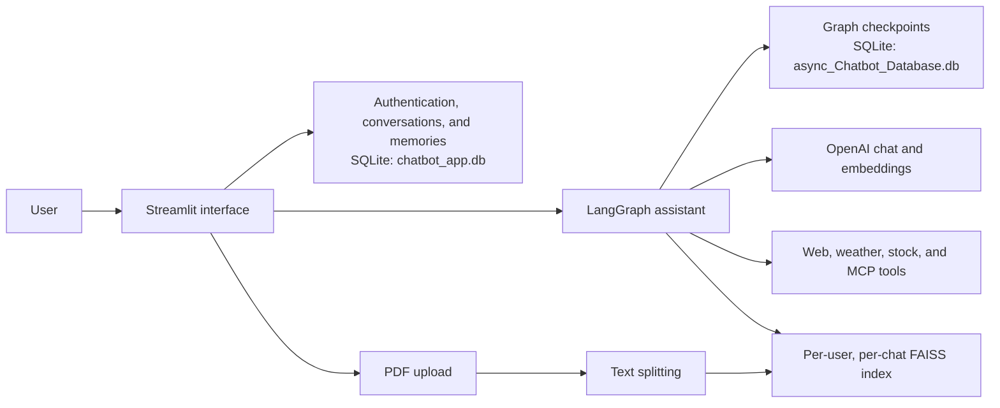

<div align="center">

# ✦ Nexora AI

### Your personal AI workspace for conversation, research, and documents.

A Streamlit chatbot that brings together private conversations, PDF question answering, useful tools, and long-term memory in one focused workspace.

[Portfolio](https://akashsharma-portfolio.onrender.com/) · [LinkedIn](https://www.linkedin.com/in/akash-sharma8017/) · [GitHub](https://github.com/Akash-sharma07)


</div>

---

## Overview

Nexora AI is a personal assistant built around persistent, account-scoped chats. Ask questions, upload a PDF for grounded answers, use connected tools, and keep useful context between conversations.

### What it can do

| Capability | What it does |
| --- | --- |
| **Personal chat workspace** | Register and sign in, then keep conversations and titles associated with your account. |
| **PDF analysis** | Upload PDFs and ask questions about their contents. Each chat has its own FAISS index, and answers are grounded in retrieved passages. |
| **Long-term memory** | Save a fact directly with `Remember: ...`, remove memories with `Forget: ...`, or let the app extract useful durable details from conversations. |
| **Web lookup** | Search the web for current information through DDGS. |
| **Weather and stock tools** | Look up weather and stock quotes when the corresponding API keys are configured. |
| **Connected MCP tools** | Route expense and calculator tasks to the configured MCP service, with an approval prompt before those tools run. |

## How it fits together



## Getting started

### Requirements

- Python 3.10 or later
- An OpenAI API key for chat, memory extraction, and PDF embeddings
- Optional API keys for weather and stock lookups
- Optional `uv` installation and the configured MCP service for expense and calculator tools

### Install

From the project directory, create and activate a virtual environment, then install the dependencies:

**Windows PowerShell**

```powershell
py -m venv .venv
.\.venv\Scripts\Activate.ps1
python -m pip install --upgrade pip
pip install -r requirements.txt
```

**macOS / Linux**

```bash
python3 -m venv .venv
source .venv/bin/activate
python -m pip install --upgrade pip
pip install -r requirements.txt
```

### Configure environment variables

Create a `.env` file in the project directory and add the keys you plan to use:

```dotenv
OPENAI_API_KEY=your-openai-api-key
ALPHAVANTAGE_API_KEY=your-alphavantage-api-key
WEATHERSTACK_API_KEY=your-weatherstack-api-key
# Optional: defaults to chatbot_app.db in the project directory
APP_DB_PATH=chatbot_app.db
```

`OPENAI_API_KEY` is needed for the assistant and PDF embedding features. The Alpha Vantage and Weatherstack keys are only needed for their respective tools. Keep `.env` private and never commit real API keys.

### Run

```bash
streamlit run frontend_memory_chatbot.py
```

Streamlit prints a local address in the terminal; open it in your browser to create an account or sign in.

## Data and storage

| Data | Current storage |
| --- | --- |
| Users, conversation titles, and long-term memories | SQLite file set by `APP_DB_PATH`; defaults to `chatbot_app.db`. |
| LangGraph conversation state and checkpoints | `async_Chatbot_Database.db` in the project working directory. |
| Uploaded PDF indexes and metadata | `faiss_indexes/<user_id>/<thread_id>/` on the local filesystem. |

These files contain application data. Protect them as you would user content, and do not commit database files, indexes, or uploaded documents to a public repository.

## Integrations and setup notes

- **OpenAI:** The backend uses OpenAI models for responses, titles, memory extraction, and PDF embeddings. Uploaded PDF text is split into chunks and sent to the embeddings API; retrieved passages are then provided to the chat model when answering document questions.
- **Weather and stock data:** Configure `WEATHERSTACK_API_KEY` and `ALPHAVANTAGE_API_KEY` to enable those lookups.
- **MCP expense and calculator tools:** The MCP server is configured in `backend_memory_chatbot.py` with a local directory path. Update that path for your environment and ensure `uv` and the MCP service are available. The rest of the app can still start if MCP initialization fails.
- **PDF storage:** FAISS indexes are local files. If you deploy multiple app instances, they will need shared storage or a separate centralized document index in addition to a shared database.

## Project layout

```text
.
├── Auth_db.py                  # SQLite accounts, conversations, and memory
├── backend_memory_chatbot.py   # LangGraph workflow, tools, and PDF retrieval
├── frontend_memory_chatbot.py  # Streamlit interface
├── requirements.txt            # Runtime Python dependencies
└── style.css                   # Nexora visual theme
```

## Memory commands

```text
Remember: I prefer concise answers.
Forget: concise answers
Forget: all
```

The app also attempts to extract a small number of useful, durable facts after a conversation turn. You can review or clear saved memories from the sidebar.

---

<div align="center">

Built with care for thoughtful, useful AI conversations.

</div>
